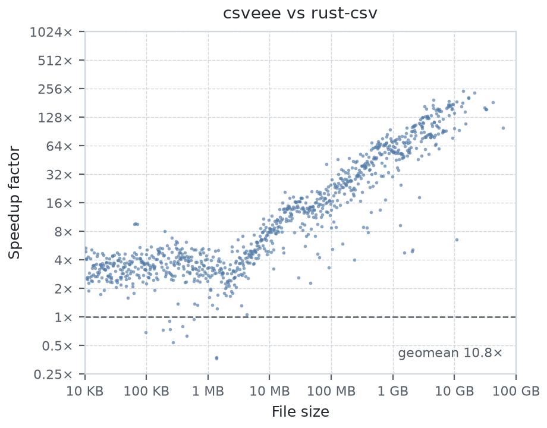
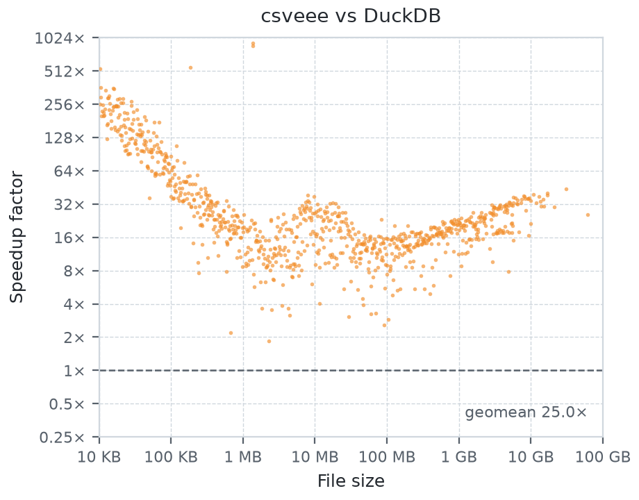

# csveee

A very fast, parallel CSV parser.

`csveee` splits a CSV file into chunks and parses them across all cores. It
inverts the usual interface: instead of the parser handing records to your
code, you hand your code to the parser. That buys what an iterator cannot —
parsing that stays lazy *and* runs in parallel. Your code runs inside the
parse, speculatively, before a chunk's record boundaries are known
([how it works](#how-it-works)).

It does all this without giving up on the messy files the real world is full
of, and it is quick about it: across 1,000 CSV files `csveee` is around
**10× faster than rust-csv**, and on a large server it peaks at **192 GB/s**.

The parsing scheme and the fused programming model come from
[*One Pass to Parse Them All: Fused Parallel CSV Processing*](https://db.in.tum.de/~ellmann/papers/csveee.pdf) (VLDB '26); the
crate has grown past the paper since, with the DFA parser, broader dialect
coverage, and more I/O backends.

## Features

- **Parallel by default.** Every chunk is parsed on its own thread and the
  per-chunk results are folded back together in file order.
- **Parsing and processing in one pass.** A file larger than the CPU caches
  passes through them once, not twice — twice would halve throughput.
- **Two chunk parsers.** A SIMD parser for the common dialects, a DFA for any
  configuration.
- **Many dialects, not just RFC 4180, real files.** Configurable delimiters,
  terminators, escapes, comments, and three different quote handling modes.
  Records of varying length, `\r\n`/`\n`/`\r` and mixed newlines, headers,
  comments, blank lines.
- **I/O picked by file size.** Per-chunk reads or a ring buffer; mmap opt-in.
- **No per-record allocation.** Fields are slices into the parser's own buffer.
  Nothing is copied unless you copy it.

## Usage

```rust
use csveee::Parser;

let mut parser = Parser::new();

let cities = parser.parse(
    "data.csv",
    Vec::new,                       // init  -> Vec<String>, one per chunk
    |state, [_name, _age, city]| {  // acc   (&mut Vec<String>, [&mut str; 3])
        state.push(city.to_string());
        Ok(())                      //        Err(_) rejects the record
    },
    |states| states.concat(),       // merge (&mut [Vec<String>]) -> Vec<String>
)?;
```

The three callbacks form a user-defined aggregate: `init` creates a state per
chunk, `acc` folds each record into it, and `merge` combines the states. The
`[_name, _age, city]` pattern declares the record arity. Fields are `&mut str`
into the parser's buffer, valid for the call only.

A chunk is parsed under an assumption about its starting state — inside a
quoted field or not. A record of the wrong arity or an error from `acc` (e.g.,
a failed type conversion) refutes it, and the chunk is parsed again under the
next assumption, from a fresh `init` state. So `acc` may see the same bytes
twice, cut into different records each time. `init` and `acc` are `Fn` and
`Sync`: they run on all the threads in parallel.

`merge` is `FnOnce`: it folds the surviving states, in file order, sequentially.

For bytes already in memory there is `parse_slice`, and for sources without
random access `parse_stream`, a sequential fallback.

### Configuration

`ParserBuilder` sets the dialect and the execution backends:

```rust
use csveee::{ParserBuilder, QuoteHandling, RecordTerminator};

let mut parser = ParserBuilder::new()
    .delimiter(b';')
    .quote(Some(b'"'))
    .quote_handling(QuoteHandling::Strict)
    .terminator(RecordTerminator::LF)
    .comment(Some(b'#'))
    .has_headers(false)
    .concurrency(4)
    .build();
```

- **Quote handling:** `Toggle` — every quote toggles quoting, whatever its
  position; `Strict` — RFC 4180, where a quote inside an unquoted field is an
  error; `Literal` — that same quote is an ordinary character.
- **Output modes:** fixed-arity arrays by default; `flexible()` hands the
  accumulator a slice so records may vary in length — validate in the
  accumulator to keep speculation cheap, see [How it works](#how-it-works);
  `bytes()` hands out `&mut [u8]` and skips UTF-8 validation entirely.
- **Execution:** concurrency, chunk size, parser backend, I/O backend, and a
  memory cap for the ring buffer.

The [`examples/`](examples) directory has a runnable program for each of these.

## Performance

Measured over 1,000 files from Kaggle on an AMD EPYC server, one point per file:

<p align="center">
  <picture>
    <source media="(prefers-color-scheme: dark)" srcset="docs/speedup-rustcsv-dark.png">
    
  </picture>
  <picture>
    <source media="(prefers-color-scheme: dark)" srcset="docs/speedup-duckdb-dark.png">
    
  </picture>
</p>

The geometric mean of per-file throughput is 7.7 GB/s — 4.7 GB/s with the DFA
parser on stable — against 0.8 GB/s for rust-csv and 0.3 GB/s for DuckDB: a
geometric-mean speedup of **10.85× over rust-csv** and **25× over DuckDB**.

The speedup is a curve. Startup is a fixed cost, so the more bytes there are
to parse the smaller its share becomes, and the parsing that remains is split
across every available core. Against rust-csv, small files spend most of their
time in startup and land nearer 2–4×; from there the margin widens with each
extra byte and each extra core, past 200× on the largest files. DuckDB pays a
fixed per-query cost of its own, so its curve starts high, bottoms out near
100 MB once that cost is amortized over enough bytes, and widens again as
parallelism takes over.

Benchmarks live in [`benches/throughput.rs`](benches/throughput.rs). Reproduce
them with:

```console
$ pip install -r scripts/requirements.txt
$ python3 scripts/provision_data.py   # downloads the corpora
$ cargo bench --features bench
```

## How it works

### Why parallel parsing is hard

A chunk boundary can land anywhere, including inside a quoted field, where a
newline does not end a record. So a worker cannot just skip ahead to the next
one: it does not know the state its chunk starts in. Known workarounds each
have a cost: counting quotes first takes an extra pass over the file, running
one state machine per possible starting state costs more still, and heuristics
for where quoted fields start and end break on real world files that do not
necessarily follow the CSV standard.

If the parser knows the shape of the records — the number of fields, say, or
their types — there is a cheaper way: parse each chunk **speculatively**, under
one possible starting state after another, until the records come out in the
expected shape. DuckDB's parser speculates the same way.

### Why not an iterator

Most CSV parsers hand out records through an iterator, as in
`for record in reader.records() { … }`. A parallel parser can take the record
shape as an argument and speculate behind that interface, but parsing stays a
speculation until every byte is processed: however unlikely, the inside of a
quoted field can look just like records of the expected shape. An iterator
cannot hand out speculative records, as it has no way to take them back if the
speculation turns out wrong. So with an iterator, parsing has to finish before
the first record is handed out, and parsing and processing take two passes over
the data — which caps throughput at half the memory bandwidth once a file
outgrows the CPU caches. A single-threaded parser does not have this problem:
its parse state is always known, so it can parse a record, hand it out, and
move on, in one pass — but on one core.

### Turning the parser inside out

`csveee` takes your code as arguments instead (see [Usage](#usage)), and with
it everything speculation needs. The record shape is the declared arity plus
whatever `acc` checks; the more these checks reject, the sooner a wrong guess
dies. Records go into per-chunk states as they are parsed, so a pass under a
wrong guess costs only the wasted work: its state is simply never merged. Every
pass is kept, not just the one that turns out to be right: on a genuinely
broken file they all end in an error, and the merge needs them all to report
the real one.

Once every chunk is parsed, the merge phase walks them in order: the pass whose
first record starts where its predecessor's last record ended is the correct
one. If none lines up, the chunk is reparsed sequentially from there. That is
rare unless the checks reject nothing — with `flexible()` and an accumulator
that accepts every record, a wrong pass runs to the end of the chunk
unchallenged. The result is correct either way. The surviving states then go
to `merge` in file order, and its result is what `parse` returns.

### Chunk parsers and I/O

There are two chunk parsers:
The **DFA parser** drives a state machine byte by byte; it supports every
configuration. The **SIMD parser** finds delimiters, terminators, and quotes 64
bytes at a time and resolves quoted regions with bit-parallel arithmetic. It
covers the common dialects, and `ParserBackend::Auto` takes it whenever the
configuration allows — the DFA otherwise. Its instruction set is picked at
runtime: on x86_64, AVX-512 or AVX2 (with BMI2 and carry-less multiply) where
the CPU has them, SSE2 otherwise; on aarch64, NEON, with `pmull` where
available. With `-C target-cpu=native`, the levels that CPU supports are
compiled in statically instead of being detected.

Input is read through one of three I/O backends. **Per-chunk reads** copy a
chunk at a time into a per-thread buffer; a **ring buffer** gives each thread
its own bounded window, for large machines or streamed input; **memory maps**
give each thread its own private mapping and let the page cache do the work.
`Auto` takes the first for small files and the second for large ones; mmap is
opt-in and Unix-only.

## Correctness

The test suite parses ~2,500 real-world CSV files — 1,000 sampled from Kaggle,
DuckDB's and Postgres's own CSV test corpora, and rust-csv's — and compares
`csveee`'s output field for field against rust-csv, across output modes, parser
backends, and I/O backends. `cargo test` runs the checked-in fixtures; the larger
corpora are downloaded by `scripts/provision_data.py` (the Kaggle suite is opt-in
and needs credentials).

## Feature flags

| Feature | Description |
| --- | --- |
| `simdutf8` | SIMD-accelerated UTF-8 validation for `Text` output. |
| `trace` | `tracing` instrumentation. |
| `bench` | Required to build the benchmarks. |

All are off by default.

## Status

Early days — the API is not stable yet and may change between releases. Requires
Rust 1.89 or newer (edition 2024). Tested on Linux, macOS, and Windows.

## Citation

If you use `csveee` in academic work, please cite the paper:

> Simon Ellmann and Thomas Neumann. One Pass to Parse Them All: Fused Parallel
> CSV Processing. PVLDB, 19(11): 3579–3591, 2026.
> [doi:10.14778/3836663.3836710](https://doi.org/10.14778/3836663.3836710)

```bibtex
@article{ellmann2026onepass,
  author  = {Simon Ellmann and Thomas Neumann},
  title   = {One Pass to Parse Them All: Fused Parallel {CSV} Processing},
  journal = {Proceedings of the VLDB Endowment},
  volume  = {19},
  number  = {11},
  pages   = {3579--3591},
  year    = {2026},
  doi     = {10.14778/3836663.3836710}
}
```

The evaluation artifacts are at
[ackxolotl/csveee-evaluation](https://github.com/ackxolotl/csveee-evaluation).

## License

Licensed under either of

- Apache License, Version 2.0 ([LICENSE-APACHE](LICENSE-APACHE))
- MIT license ([LICENSE-MIT](LICENSE-MIT))

at your option.

### Contribution

Unless you explicitly state otherwise, any contribution intentionally
submitted for inclusion in the work by you, as defined in the Apache-2.0
license, shall be dual licensed as above, without any additional terms or
conditions.
